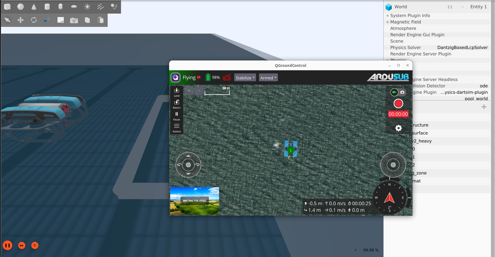

# Mira Simulator

Gazebo Harmonic and ArduSub SITL for BlueROV2, with SAUVC and TACC competition worlds.



Requires Linux, Python 3, Docker Compose v2 and tmux. GUI runs also need X11/XWayland. NVIDIA acceleration is detected automatically; set `MIRA_GPU=0` or `1` to override.

## Simulator

```bash
python3 bringup.py submodules
python3 bringup.py up --map sauvc
python3 bringup.py attach
python3 bringup.py down
```

Tmux session `mira-sim` has separate `gazebo`, `sitl` and `bridge` windows. Exited panes remain visible for log inspection. QGroundControl connects on UDP 14550.

Maps: `sauvc` (competition), `sauvc_quali`, `tacc`, `bluerov`.

```bash
python3 bringup.py up --map tacc --headless
python3 bringup.py up --map sauvc --no-sitl
python3 bringup.py up --mode gazebo --map tacc  # Gazebo alone
python3 bringup.py shell                       # Gazebo container shell
python3 bringup.py check                       # Validate Compose and print commands
python3 bringup.py build                       # Rebuild simulator images
```

Stop the current run before changing maps or modes. `down` stops only the simulation containers and tmux session while retaining runtime data.

## Connect the Mira stack

In Mira's normal container or configured ROS environment:

```bash
make guided-sim
# Or: ros2 launch mira2_hardware guided_sim.launch.py
```

The new launch reuses the normal guided stack, supplies localhost SITL links and Gazebo sensor topics, and enables simulation time. `mira2_vision` already accepts ROS image topics. Actions remain a separate normal Mira launch.

There are three containers when both are running: Gazebo, SITL, and the original Mira container. The simulator never starts or stops Mira. Build Mira using its normal commands after adding the launch file.

See [connection settings](misc/doc/MIRA_STACK.md) for topic overrides, optical flow, coordinate origins and optional auto-arming.

## Layout

```text
mira_sim/
├── bringup.py                 # Simulator commands, configuration and tmux lifecycle
├── docker-compose.yml         # Gazebo and SITL
├── docker/                    # Simulator Dockerfiles and entrypoint
├── config/ardupilot/           # Global frame and simulator parameters
├── misc/
│   ├── doc/                   # Guides, reports and media
│   ├── infra/                 # Host helpers
│   ├── patches/               # Third-party patches
│   └── tools/                 # Diagnostics (inside Mira: /sim/misc/tools)
├── src/
│   ├── ardupilot_gazebo/       # ArduPilot plugin submodule
│   ├── bluerov2_gz/            # Vehicle models submodule
│   ├── sauvc_sim/              # Competition worlds, models and config (submodule)
│   ├── tacc_sim/               # Competition worlds, models and config
│   └── dnt_simulator/          # Gazebo-to-ROS bridge launch files
└── var/                       # Persistent SITL parameters and logs (ignored)
```

Optional host ROS development: `python3 bringup.py install-deps`, `host-build` (optionally `--package NAME`), and `clean`. Requires ROS Jazzy and uv on the host; container simulation does not require host ROS.

Apache License 2.0; see [LICENSE](LICENSE).
